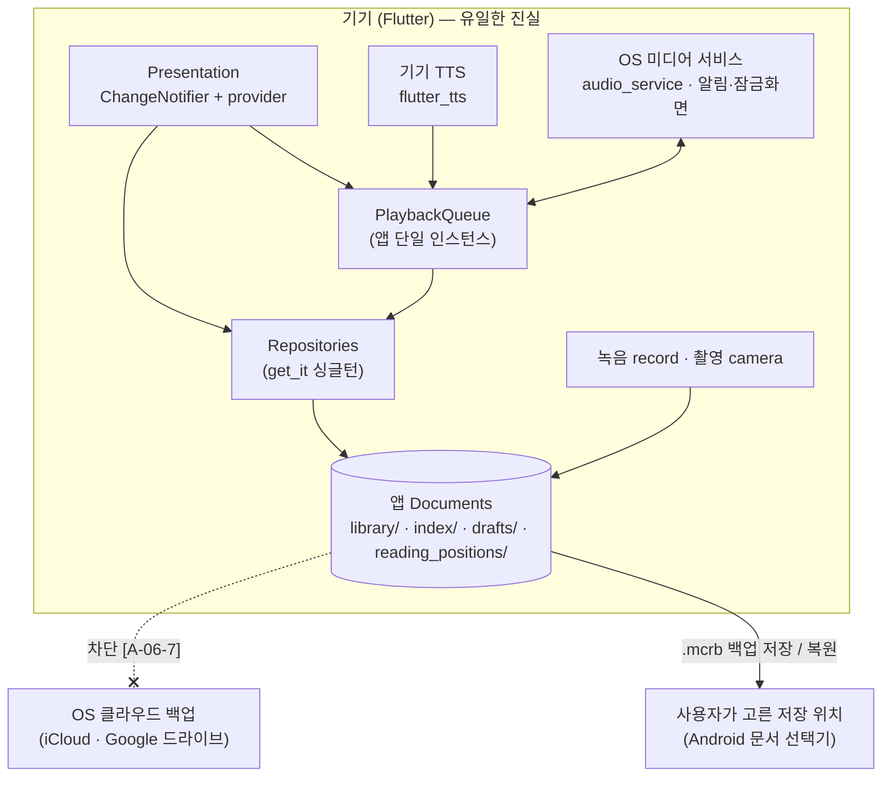
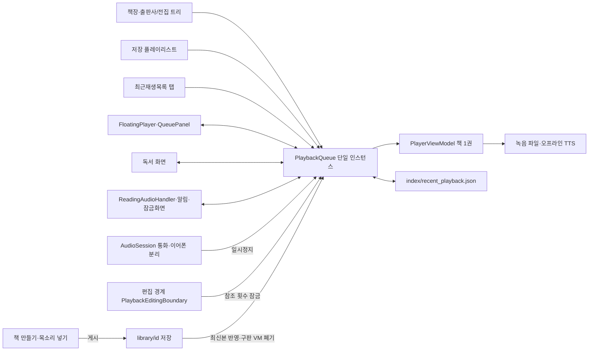
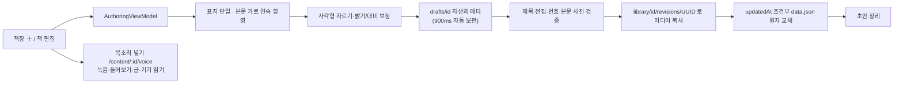
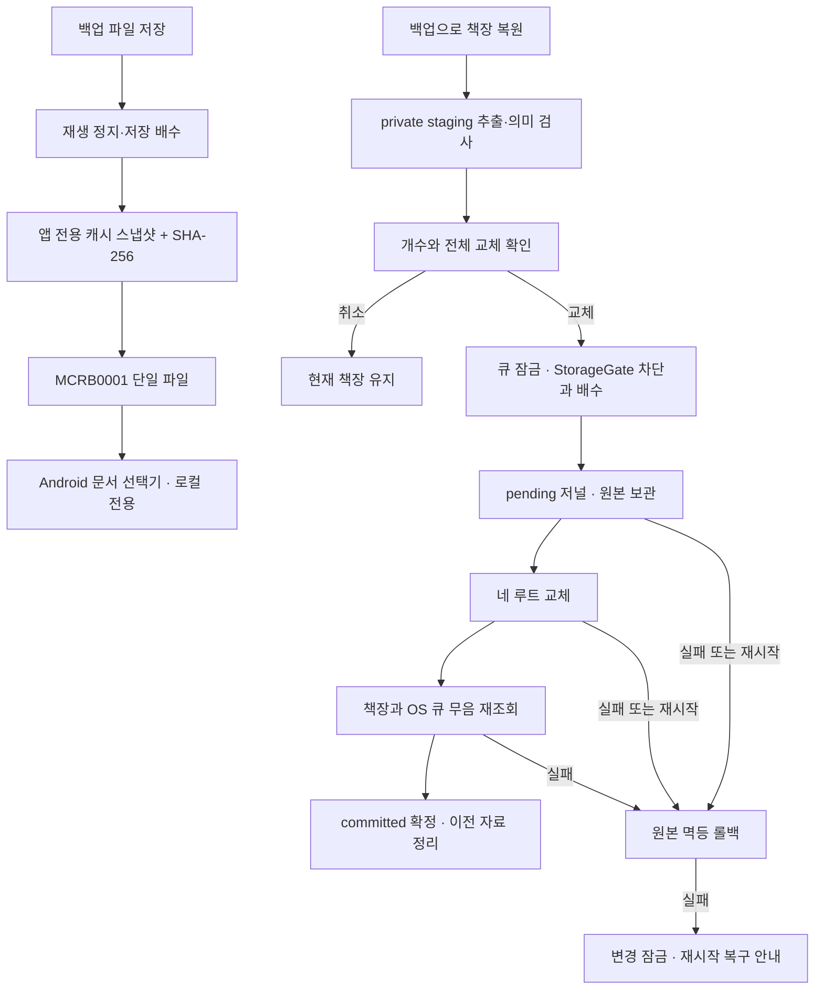
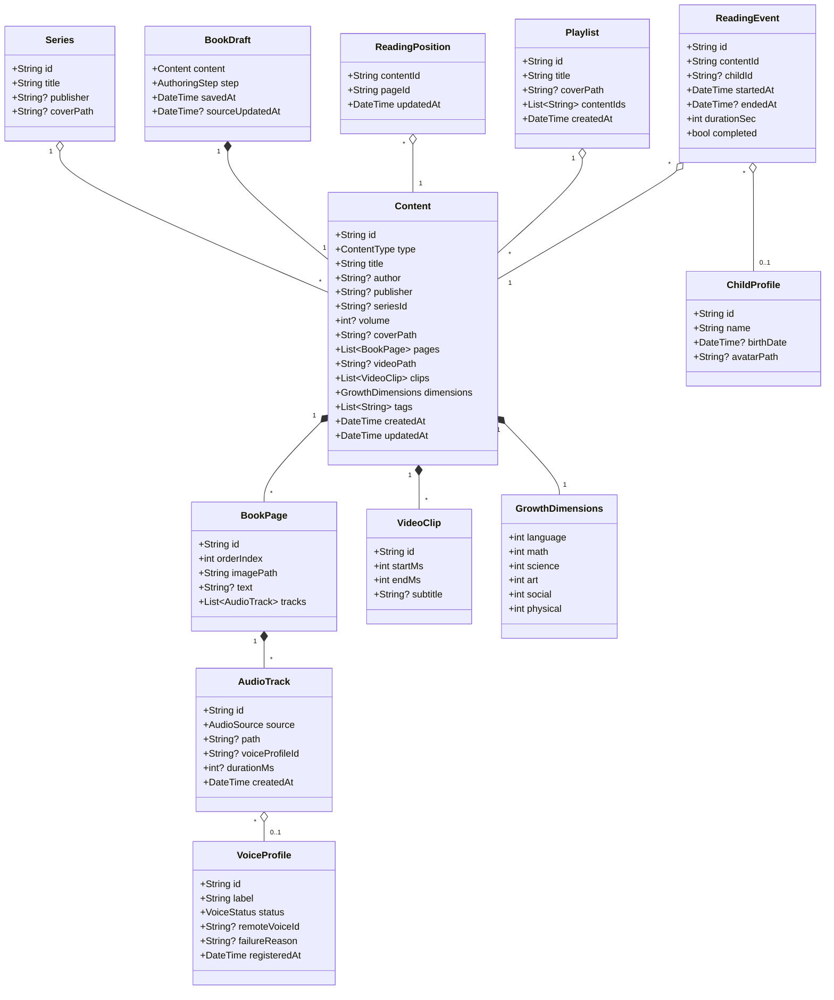

# 1_DESIGN — mychild-reading 설계

> **이 문서가 설계 SSOT 다.** 구현 규약 [2_DEVELOPMENT.md](2_DEVELOPMENT.md) · 검증 [3_TEST.md](3_TEST.md) · 배포 [4_DEPLOYMENT.md](4_DEPLOYMENT.md)
> 참조 표준: `[A-01]` 스택 · `[A-03]` 구조 · `[A-06]` 보안(아동 특칙 §7) · `[A-08]` 에러/로깅 · `[A-15]` 가시화 · `[A-16]` 오프라인 큐 · `[A-21]` AI-Optional · `[A-22]` AI 패턴 · `[B-02]` 모바일
>
> **현행(2026-10-06):** 기기 안에서만 동작하는 로컬 앱이다 — 네트워크 코드 0, Firebase 미도입, 릴리스 매니페스트에 `INTERNET` 권한 없음.
> 화면·데이터 흐름의 상세 정본은 [specs/astra-reading/design.md](specs/astra-reading/design.md), 실행 단계는 [tasks.md](specs/astra-reading/tasks.md).

<!-- toc -->

- [1.1 개요](#11-개요)
- [1.2 시스템 아키텍처](#12-시스템-아키텍처)
- [1.3 데이터 모델](#13-데이터-모델)
- [1.4 설계 결정 (ADR)](#14-설계-결정-adr)
- [1.5 마일스톤 분할](#15-마일스톤-분할)
- [1.6 보안 · 개인정보](#16-보안--개인정보)
- [1.7 품질 · 비기능](#17-품질--비기능)
- [1.8 변경 이력](#18-변경-이력)

<!-- tocstop -->

---

## 1.1 개요

### 무엇을 만드나

집에 있는 **종이책**을 사진으로 찍어 디지털화하고, **부모 목소리로 읽어주는** 가족용 앱이다(앱 이름 "작은 도서관").

- **사용자:** 보호자(촬영·녹음·관리) + 아이(고르고 듣기)
- **핵심 가치:** 부모가 바쁠 때도 **부모 목소리로** 책을 들려준다
- **성격:** 가족 단위 개인 앱. 스토어 배포·공개 서비스가 아니고 다른 가족과 데이터를 공유하지 않는다

### 왜 로컬 우선인가

책 페이지 사진과 녹음 파일은 **용량이 크고 사적이다.** 클라우드에 올리면 비용(무료 티어 5GB)과
개인정보 위험(아동 사진·부모 목소리)이 동시에 늘어난다. 그래서 **기기 로컬이 유일한 진실**이고,
기기 밖으로 나가는 경로는 사용자가 직접 저장 위치를 고르는 `.mcrb` 백업 파일 하나뿐이다(§1.6).
클라우드(Firebase)는 M2 연동 단계의 **계획**이며 아직 도입하지 않았다.

### 세 가지 오디오

한 페이지에 **여러 목소리를 동시에 보유**하고 재생 중 전환한다. 이게 이 앱 설계의 중심이다.

| 오디오 | 만드는 방법 | 상태 |
| :--- | :--- | :--- |
| **부모 직접 녹음** | 보호자가 책장 메뉴 "목소리 넣기"에서 페이지별로 녹음 | ✅ 구현 |
| **기기 TTS** | OS 내장 엔진이 런타임 합성(파일 없음). Android 는 `network_required=0` 오프라인 한국어 음성만, iOS 는 오프라인 여부를 확인할 수 없어 쓰지 않는다 | ✅ Android 만 |
| **AI 부모 목소리** | 목소리 샘플을 참조로 합성 — **처리자 미정**(§1.5 M3) | ⚪ M3 |

---

## 1.2 시스템 아키텍처

### 전체 구성 (현행)



- **네트워크 호출이 없다.** Firebase·HTTP 클라이언트 의존성이 없고 릴리스 매니페스트에 `INTERNET` 이 없다
  (디버그·프로파일 매니페스트의 `INTERNET` 은 Flutter 개발 도구용 템플릿 기본값).
- **OS 클라우드 백업을 막는다** — Android `allowBackup=false`·`dataExtractionRules`, iOS `isExcludedFromBackup`(§1.6, ADR-11).

### 계획 구성 (미도입)

| 단계 | 구성 | 상태 |
| :--- | :--- | :--- |
| M2 연동(실행 4단계) | Firebase Auth(보호자 Google) · Firestore 경량 메타 · Storage 백업 번들 | ⚪ **미도입** — 도입 전에 데이터별 업로드·잔존·삭제 범위를 확정한다 |
| M3 AI 목소리(실행 5단계) | 목소리 등록 → 책별 음원 생성 2단 파이프라인 | ⚪ **AI 처리자 미정** — 설계 당시 처리자(101 로컬 GPU 워커·XTTS v2)는 2026-10-05 101 폐지로 없다. M3 착수 시 처리자·잡 계약·전송 경로를 재설계한다 |

### 화면 구조와 공통 재생

하단 4탭(책장·플레이리스트·최근재생목록·설정)과 공통 플로팅 플레이어가 **하나의 `PlaybackQueue`** 를 공유한다.
화면별 상세 동작·토큰은 [specs/astra-reading/design.md](specs/astra-reading/design.md) 가 정본이다.



- 저장 Playlist 와 재생 큐는 독립이다. 큐 수정·비우기와 Playlist 삭제는 원본 책을 지우지 않는다.
- 서비스 준비 성공 시 앱 비활성화·화면 잠금에도 재생을 유지하고, 통화·이어폰 분리·편집 진입에는 멈춘다(자동 재개 없음).
  서비스 준비 실패 시 전경 재생으로 폴백한다. OS 에는 제목·쪽수·책 ID 만 넘기고 이미지·본문·경로는 넘기지 않는다.

### 책 제작과 게시



### 백업 · 복원 (2026-09-22 · 09-28)

설정 → 백업 파일. **Android 만** 동작한다(iOS 는 버튼 비활성 — §1.6).



- 형식: `MCRB0001` + u32 BE manifest 길이 + manifest JSON(`mychild-reading-directory-backup`, version=1, files[{path,size,sha256}]) + 원본 바이트.
  상한 — 파일 20,000 · 엔트리 40,000 · 깊이 16 · 경로 1,024자 · 전체 20GiB · manifest 8MiB · JSON 파일당 8MiB/합계 64MiB.
- 복원은 합치기가 아니라 네 루트(`library`·`index`·`drafts`·`reading_positions`) **전체 교체**다.
  `.restore-transaction/`(incoming·old·journal.json)을 같은 볼륨 rename 으로 다루고, 앱 시작 시 저장소 등록 **전에** 저널을 복구한다.
- 물리적 전원 손실에 대한 파일시스템 내구성까지 보장한다고 주장하지 않는다.

---

## 1.3 데이터 모델

### Bounded Context

| 컨텍스트 | 책임 | 상태 |
| :--- | :--- | :--- |
| **Library** | 출판사→전집→콘텐츠 계층, 책장 검색·분류 | ✅ |
| **Authoring** | 표지·본문 촬영, 자르기·보정, 초안, 게시 | ✅ (OCR 은 M2 편의) |
| **Playback** | 공통 큐·플레이어·저장 플레이리스트·최근재생목록·OS 미디어 | ✅ |
| **Backup** | `.mcrb` 저장·검사·복원 트랜잭션 | ✅ Android |
| **Growth** | 독서 이벤트 기록 + 6각형 지표 | 🟡 엔티티·저장소만(M4 화면) |
| **Voice** | 목소리 프로필 등록·관리 | ⚪ 엔티티·저장소 자리만(M3) |
| **Family / Sync** | 다자녀 프로필, 인증·메타 동기화 | ⚪ 엔티티·저장소 자리만(M2) |

### 엔티티



- 최근재생목록(`RecentPlayback`)은 엔티티가 아니라 `bookIds`·`currentId` 만 담는 저장 레코드다(최대 1,000권, 삭제된 ID 는 복원 시 제외).
- `VoiceProfile`·`ChildProfile`·`VideoClip`·`GrowthDimensions` 는 M2~M4 용 **선정의**다 — 저장소는 DI 에 등록돼 있으나 화면이 없다.
  `GrowthDimensions` 편집 화면은 2026-10-06 죽은 코드 정리로 사라졌고(열리지 않던 `ContentEditScreen`), 값은 기본 0 으로 저장된다. M4 에서 화면을 다시 만든다.

### Enum

```
ContentType   : pagedBook | video
AudioSource   : deviceTts | parentRecording | aiClonedVoice | aiNarration
VoiceStatus   : pending | ready | failed
```

> **`AudioSource` 4종을 처음부터 정의한다.** 멀티트랙이 설계의 중심이라 나중에 값을 추가하면
> 저장 포맷·마이그레이션을 다시 만져야 한다. enum 값만 있고 구현이 없는 비용은 0이다(ADR-6).
> 반면 AI 잡 enum(`AiJobType`·`AiJobStatus`)은 2026-10-06 지웠다 — 저장 포맷에 들어가지 않는 값이고, 처리자가 미정이라 계약 자체가 다시 정해진다.

### 로컬 파일 레이아웃

```
{AppDocumentsDir}/                 # OS 클라우드 백업 제외 (ADR-11)
├── library/{contentId}/
│   ├── data.json                  # Content — {schemaVersion:1, data} 봉투
│   ├── cover.jpg · pages/page_000.jpg …
│   ├── audio/{pageId}_{source}[_{voiceProfileId}].m4a
│   └── revisions/{uuid}/…         # 게시 때 복사한 미디어 (자동 GC 없음)
├── index/
│   ├── series.json · playlists.json · children.json
│   ├── voice_profiles.json · reading_events.json
│   └── recent_playback.json
├── drafts/{contentId}/data.json + assets/
├── reading_positions/{contentId}/data.json
└── .restore-transaction/          # 복원 중에만 존재 — 수동 삭제 금지
```

- **메타데이터 1차 = 로컬 JSON.** 경로 규칙의 코드 정본은 `lib/data/local/app_paths.dart`.
- Content 에는 **상대 경로만** 저장한다 — iOS 앱 디렉토리 절대 경로는 재설치·복원 때 바뀐다.
- 기기 TTS 트랙은 **파일이 없다**(`path = null`). 런타임 합성이라 백업에도 담기지 않는다.

### Firestore / Storage (계획 — 미도입)

M2 연동 단계에서 도입할 때의 경계다. **지금은 앱이 어떤 클라우드 경로도 쓰지 않는다.**

| 경로 | 용도 | 단계 |
| :--- | :--- | :--- |
| `users/{uid}/contents/{id}` | 콘텐츠 **경량 메타**(제목·저자·페이지수·태그·갱신시각). 미디어 경로·바이너리 제외 | M2 계획 |
| `users/{uid}/backups/{id}` | 백업 인덱스 | M2 계획 |
| Storage `backups/{uid}/*` | 백업 번들 — 도입 시 암호화 여부를 먼저 결정 | M2 계획 |

- **전역 컬렉션 쓰기 금지.** 모든 경로는 `users/{uid}/` 하위다.
- M3 잡 경로(옛 `voice_jobs`·`book_ai_jobs`)는 처리자와 함께 재설계한다. 옛 컬렉션의 남은 데이터 처리는 `comfunny-total-system` 의 `200-apps-games/apps/AGENTS.md` R-8 오너 결정 대기.

---

## 1.4 설계 결정 (ADR)

결정을 바꾸면 행을 추가하거나 사유를 갱신한다. **삭제하지 않는다.**

| # | 결정 | 왜 | 기각한 대안 |
| :--- | :--- | :--- | :--- |
| **1** | **로컬 우선 (Local-First)** — 기기가 1차 진실, 클라우드는 (도입 시) 백업·메타 전달만 | 책 사진·녹음은 크고 사적이다. 클라우드 보관은 무료 티어(5GB)와 아동 개인정보 위험을 동시에 키운다. 부수 효과로 오프라인 동작 | 클라우드 우선 = 용량 비용 + 오프라인 불가 + 아동 데이터 상시 외부 보관 |
| **2** | **상태관리 = provider** (`ChangeNotifier`) + **DI = get_it** | `[B-02]` `[현행]` 표준이 provider 다. 저장소·서비스는 상태가 아니라서 get_it 에 두고 provider 는 화면 상태 전용으로 남긴다 | **Riverpod 기각** — 옛 설계(2026-06)였으나 `[확장]` 항목. 표준을 벗어날 근거가 없다 |
| **3** | **AI 는 M3 로 미룬다** | `[A-22 §6]` GATE — "도메인 시스템이 먼저, AI는 그 위에". 페이지 구조가 흔들리는 중에 음원을 만들면 구조를 고칠 때마다 음원이 무효가 된다 | M1 에 AI 포함 = 재작업 확정 |
| **4** | **클라우드 TTS 배제** — 외부로 텍스트를 보내지 않는다 | **오너 결정(2026-09-12).** `[A-06-7]` 은 TTS 를 조건부 허용하지만 아동 앱에서 그 예외를 만들 값이 크지 않다 | **edge-tts 기각** — 품질은 좋고 무료지만 본문이 외부 서버로 간다 |
| **5** | **AI 목소리는 참조 방식(zero-shot), fine-tuning 안 함** | 짧은 샘플로 즉시 합성 — 학습 대기·GPU 시간이 없다. ⚠️ 설계 당시 엔진(XTTS v2)은 업스트림이 아카이브 상태이고 처리자(101)도 폐지됐다 → **M3 재설계 때 엔진과 함께 재검토** | fine-tuning = GPU 수십 분~시간 단위, 1인 운영에 과하다 |
| **6** | **`AudioSource` 4종을 선정의**, 구현은 단계별 | 나중에 값을 추가하면 저장 포맷·마이그레이션을 다시 만진다. enum 값만 두는 비용은 0 | 필요할 때 추가 = 포맷 변경 + 기존 데이터 마이그레이션 |
| **7** | **AI 음원은 블록 단위 캐시 해시** (M3) | 텍스트 일부만 고쳤을 때 전체 재합성은 연산 낭비. M3 재설계 때 처리자와 함께 계약을 다시 적는다 | 페이지 통째 재생성 = 오타 하나에 전체 재합성 |
| **8** | **클라우드 Storage 는 전달 통로, 보관소 아님** (도입 시) | 무료 5GB 보호 + 로컬 우선 정합. 목소리 샘플은 **생체정보**라 클라우드 잔존 자체가 위험 `[A-06]` | Storage 보관 = 용량 압박 + 아동·생체 데이터 상시 외부 보관 |
| **9** | **저장소는 JSON 파일, SQLite 안 씀** | 가족 단위 규모다. 인터페이스로 추상화해 두면 교체가 자명하다. 코드 생성기(freezed·json_serializable)도 쓰지 않는다 — 수동 `toJson`/`fromJson` 으로 방어적 파싱을 직접 통제 | Drift 즉시 도입 = 의존성·코드젠·마이그레이션 비용 대비 효용 낮음 |
| **10** | **Flutter 앱을 모듈 루트에 직접 배치** (`app/` 중첩 없음) | 옛 구조는 `server/`(Python) 옆이라 `app/` 로 감쌌다. 지금 이 폴더에는 Flutter 앱만 있다 | `app/` 유지 = 이유 없는 중첩 |
| **11** | **OS 클라우드 백업 차단** (2026-10-06 오너 결정) — Android `allowBackup=false`·`fullBackupContent=false`·`dataExtractionRules`(클라우드·기기 이전 모두 제외), iOS Documents `isExcludedFromBackup` | 아이 사진·보호자 녹음이 사용자가 의식하지 못한 채 iCloud·Google 드라이브로 나가는 것을 막는다 `[A-06-7]`. 기기 밖 경로는 사용자가 고르는 `.mcrb` 하나로 좁힌다 | OS 백업 허용 = 편하지만 아동 데이터가 제3자 클라우드에 상시 보관 / 기기 이전만 허용 = 규칙이 둘로 갈려 관리가 어렵다 |
| **12** | **백업은 사용자가 고른 로컬 위치의 단일 `.mcrb` 파일, 암호화 없음** (2026-09-22) | 클라우드 전송 없이 기기 교체·손실에 대비하는 최소 경로. 암호화는 키 관리(분실 = 복구 불가)가 따라와 첫 단계에서 뺐다 — 화면에서 비암호화임을 알린다 | 클라우드 자동 백업 = ADR-1·11 위배 / 암호화 우선 = 키 분실 시 가족 자료 전체 손실 |
| **13** | **복원은 같은 baseDir 의 네 루트를 저널+rename 으로 교체, DI·오디오 핸들러는 유지** (2026-09-28) | 저장소가 자료를 캐시하지 않아 파일만 바꾸고 같은 큐를 무음 재조회하면 된다. DI·AudioService 를 다시 만들면 OS 핸들러 참조가 갈라진다 | DI 재생성 = 참조 분리 위험 / 합치기 복원 = 충돌 규칙이 필요해 범위 초과 |
| **14** | **iOS 는 백업 경로 없이 둔다** (2026-10-06 오너 수용) | iOS 파일 선택 UI 를 아직 만들지 않았고, ADR-11 로 iCloud 백업도 막았다 → **iOS 기기 분실 = 데이터 손실**. 오너가 이 트레이드오프를 받아들였다 | iCloud 백업 허용 = ADR-11 과 충돌 |

---

## 1.5 마일스톤 분할

분할 기준은 **"각 단계가 그 자체로 쓸 수 있는가"** 다. 2026-09-19 부터 실행 단계 0~6 으로 진행한다 —
정본은 [tasks.md](specs/astra-reading/tasks.md).

| M | 실행 단계 | 범위 | 상태 |
| :--- | :--- | :--- | :--- |
| **M1** | 1 로컬 MVP | 책장 · 촬영/자르기 · 부모 녹음 · 기기 TTS · 공통 플레이어 · 플레이리스트 · 백그라운드 재생 · `ReadingEvent` 기록 | 🟡 구현 완료, 실기기 E2E 남음 |
| **M2a** | 2 안정화 | 백업/복원 · 권한·중단·누락 대응 | 🟡 백업/복원 구현(Android), 실기기 수락 남음 |
| **M2b** | 3 편의 | OCR(ML Kit 온디바이스) · 다자녀 · 연령 분류 | ⚪ 미착수 |
| **M2c** | 4 연동 | Google 인증 · 가족 격리 · 메타 동기화 · `[A-16]` 큐 (Firebase 도입) | ⚪ 미착수 |
| **M3** | 5 AI 목소리 | 목소리 등록 → 책별 음원 생성 · 관측성 · 폴백 | ⚪ **AI 처리자 미정(2026-10-05 101 폐지) — M3 착수 시 재설계** |
| **M4** | 6 확장 | 동영상·클립·자막 · 성장 6각형 통계 | ⚪ 미착수 |

**M3 착수 조건 = `[A-22 §6]` GATE:**

- [ ] **G1** 핵심 도메인(책장·페이지·플레이어)이 실기기에서 실제 가동
- [ ] **G2** 이 문서 범위와 코드가 일치
- [ ] **G3** 흐름 가시화 완료 (`[A-15]`)
- [ ] **G4** 설계↔코드 일치를 검증하는 테스트 존재
- [ ] **G5** 도메인 핵심 로직에 한국어 "왜" 주석
- [ ] **G6** 용어·에러코드 정합
- [ ] **추가** 처리자(로컬 실행 위치·엔진·라이선스)·잡 계약·전송 경로를 새로 설계하고 ADR 로 남긴다 — 클라우드 AI 배제(ADR-4)는 유지

> AI 가 안 붙어도 실패가 아니다. M1 만으로 "내가 읽어 녹음하면 아이가 넘겨보며 듣는다" 가 성립한다.
> 처리자가 없어도 기기 TTS·녹음으로 완전 동작해야 한다 `[A-21]`.

---

## 1.6 보안 · 개인정보

**아동 앱이다.** `[A-06]` 일반 규정에 더해 **§7 아동·가족 특칙**이 적용된다.

| 요구 | 현행 | 근거·위치 |
| :--- | :--- | :--- |
| **기기 밖 전송 없음** | 네트워크 코드 0. 릴리스 매니페스트에 `INTERNET` 없음. 클라우드 LLM·TTS 미사용(ADR-4) | `android/app/src/main/AndroidManifest.xml` |
| **OS 클라우드 백업 차단** (2026-10-06) | Android: `allowBackup=false`·`fullBackupContent=false`·`dataExtractionRules`(클라우드 백업·기기 이전 모두 전 도메인 제외). iOS: 앱 시작마다 Documents 에 `isExcludedFromBackup=true` | `AndroidManifest.xml` · `res/xml/data_extraction_rules.xml` · `ios/Runner/AppDelegate.swift` (ADR-11) |
| **`.mcrb` 백업 파일 위험** | 파일은 **암호화되지 않고** 아이 사진·보호자 녹음을 그대로 담는다. 저장 위치는 사용자가 Android 문서 선택기에서 고른다(로컬 전용) — 사용자가 클라우드 동기화 폴더를 고르면 그 서비스로 간다. 화면에 비암호화임을 알린다 | ADR-12. **후속:** 암호화 옵션(키 분실 시 복구 불가 안내 포함) |
| **iOS 백업 경로 없음** | 백업 버튼이 비활성이고 iCloud 백업도 막혀 **iOS 기기 분실 = 데이터 손실** | ADR-14 — 오너 수용(2026-10-06) |
| **로그·OS 노출 최소화** | 오류 로그·안내문에 가족 파일 경로·내용을 넣지 않는다. OS 미디어 세션에는 제목·쪽수·책 ID 만 | `[A-08]` |
| **아동 단독 가입 경로 금지** | 로그인 자체가 없다. 인증 도입(M2c) 시 **보호자 Google 계정만**, 아이는 `ChildProfile` 로 종속 | — |
| **아동 데이터 최소 수집** | `ChildProfile`(이름·생일·아바타, 생일 선택)은 화면 없이 선정의만 | M2b |
| **가족 데이터 격리** (도입 시) | Firestore·Storage 경로 `users/{uid}/**`, `allow read: if true` 금지 | M2c |
| **생체정보** (M3) | 목소리 샘플은 처리자가 받은 뒤 전달 경로에서 즉시 삭제(ADR-8). 처리자 재설계 때 보관 위치를 다시 정한다 | M3 |
| **부모 확인** | 만들던 책·플레이리스트 편집 진입의 확인은 **우발 조작 방지**이며 인증·보안 경계가 아니다 | — |

**Zero-Cost 준수** (`[A-01-2.6]`) — 유료 에셋·구독·상용 라이선스를 쓰지 않는다. 의존성 라이선스는 [2_DEVELOPMENT §2.1](2_DEVELOPMENT.md#21-개발-환경).

---

## 1.7 품질 · 비기능

목표와 현행을 분리해 적는다. **달성하지 않은 것을 달성한 것처럼 적지 않는다.** 테스트 수치의 정본은 [3_TEST §3.4](3_TEST.md#34-검증-기록).

| 항목 | 목표 | 현행 (2026-10-06) |
| :--- | :--- | :--- |
| **오프라인 동작** | 네트워크 없이 등록·녹음·재생 전부 | ✅ 코드상 네트워크 의존 0. 🟡 비행기 모드 실기기 검증은 미실행 |
| **상태관리** | provider `ChangeNotifier`, 화면당 1 VM | ✅ Catalog·Library·Authoring·Player·Backup VM + 앱 수명 `PlaybackQueue` |
| **테스트** | 직렬화 round-trip + 저장소·복원 + VM·위젯 | ✅ 전건 통과 / 🟡 플레이어 위젯 14건 보류 |
| **정적 분석** | `flutter analyze` 무이슈 | ✅ No issues found |
| **에러/로깅** | `AppLogger`(`print` 금지), 에러코드 `E-MCR-*` `[A-08]` | ✅ 6코드(400·404·409·500·510·511) |
| **다운그레이드 안전** | 모르는 값·미래 스키마에서 데이터를 잃지 않는다 | ✅ `json_codec` 방어적 파싱 + `JsonStore` 스키마 봉투(미래 버전 거부) |
| **원자적 저장** | 쓰는 중 앱이 죽어도 원본이 남는다 | ✅ 임시파일 → `rename`, 복원은 저널 롤백 |
| **접근성** | 큰 터치 타깃·명확한 대비·글자 확대 | 🟡 터치 56dp, 주요 8조합 대비 5.63~12.94:1, 320폭·글자 1.6~1.8배 검사. 스크린리더 실기기 미점검 |
| **개인정보** | §1.6 전항목 | ✅ 코드 반영 / ⚪ iOS 백업 제외는 Swift 컴파일 미실행(이 맥에서 iOS 빌드 불가) |
| **AI-Optional** | 처리자 없이도 완전 동작 `[A-21]` | ✅ M1 이 AI 없이 완결 |

---

## 1.8 변경 이력

일지성 기록을 접은 요약이다. 단계별 상세 검증은 [3_TEST §3.4](3_TEST.md#34-검증-기록).

| 날짜 | 변경 |
| :--- | :--- |
| 2026-09-12 | 재구축 착수 — 옛 코드·Riverpod 설계 폐기, provider·로컬 JSON 으로 도메인·저장소·책장·플레이어 구현 |
| 2026-09-19 | Astra UX 재구성 0~1-2: 초안·읽던 위치 저장소, 촬영·녹음 제작 화면, 게시 revision·조건부 교체 |
| 2026-09-19~20 | 1-4~1-5: 음악 앱형 4탭·저장 플레이리스트·공통 큐·플로팅 플레이어·백그라운드 재생, 책방 표현 |
| 2026-09-20 | 책 등록 단순화(전집·번호 필수, 단일 저장), 본문 가로 연속 촬영, 사진 자르기·보정, 목소리 넣기 분리 |
| 2026-09-20 | 2-1 디렉터리 백업 기반(SHA-256 검증, 새 경로 복원) |
| 2026-09-22 | 2-2a `.mcrb` 백업 파일 저장·검사(Android SAF) |
| 2026-09-28 | 2-2b 현재 책장 복원 — 저널 트랜잭션·StorageGate·재시작 복구 |
| 2026-10-06 | 묶음 재편(`200-apps-games/apps/01-mychild-reading`), 죽은 코드 정리(`LibraryScreen`·`ContentEditScreen`·AI 잡 enum·`E-MCR-503`·`cupertino_icons`), **OS 클라우드 백업 차단**, 문서 실측 현행화 |
