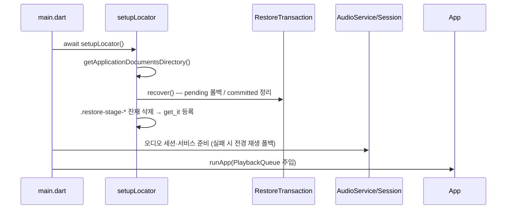

# 2_DEVELOPMENT — mychild-reading 개발 문서

> 설계 SSOT 는 [1_DESIGN.md](1_DESIGN.md). 이 문서는 **환경·구조·구동 흐름·기능 추가 절차**를 다룬다.
> 검증 [3_TEST.md](3_TEST.md) · 배포 [4_DEPLOYMENT.md](4_DEPLOYMENT.md) · 표준 `[B-02]` `[A-02]` `[A-03]` `[A-08]`
>
> **실측 2026-10-06:** `lib/` dart 67파일 / 10,287줄 · `test/` 24파일 / 5,585줄 (`find lib test -name '*.dart'`).

<!-- toc -->

- [2.1 개발 환경](#21-개발-환경)
- [2.2 폴더 구조](#22-폴더-구조)
- [2.3 구동 흐름](#23-구동-흐름)
- [2.4 구현 규약](#24-구현-규약)
- [2.5 기능 추가 절차](#25-기능-추가-절차)

<!-- tocstop -->

---

## 2.1 개발 환경

### 스택 (2026-10-06 실측)

| 구분 | 선택 | 근거 |
| :--- | :--- | :--- |
| **런타임** | **Flutter 3.47.3** / Dart 3.13.3 (`sdk: ^3.13.3`) | `flutter --version` |
| **상태관리** | **`provider`** (`ChangeNotifier`) — Riverpod 아님 | `[B-02]` `[현행]` · [ADR-2](1_DESIGN.md#14-설계-결정-adr) |
| **DI** | `get_it` — 저장소·서비스 싱글턴 | provider 는 화면 상태 전용 |
| **라우팅** | `go_router` | `[B-02]` §2.1 |
| **직렬화** | 수동 `toJson`/`fromJson` + `core/json_codec.dart` — **freezed·json_serializable 없음** | [ADR-9](1_DESIGN.md#14-설계-결정-adr): 방어적 파싱을 직접 통제 |
| **클라우드** | **없음** — Firebase·HTTP 클라이언트 미도입 | M2c 연동 단계에서 도입(1_DESIGN §1.2 계획 구성) |

### 최초 셋업

```bash
# PATH 에 Homebrew Flutter 가 없으면 먼저 추가한다 (Finder 실행 .command 도 같은 보정을 한다)
export PATH="/opt/homebrew/bin:$PATH"

# 저장소 루트에서
flutter pub get        # 기대: Got dependencies!
flutter analyze        # 기대: No issues found!
flutter test           # 기대: All tests passed! (보류 14건 표시 — 3_TEST §3.4)
```

| 플랫폼 | 상태 | 남은 것 |
| :--- | :--- | :--- |
| `flutter test`·`analyze` | ✅ 플랫폼 불필요 | — |
| **Android** | ✅ `flutter build apk --debug` 성공 (첫 빌드 약 4분 — Gradle 이 NDK·CMake 를 받는다) | JDK 는 `openjdk@17`(AGP 8.x 공식 지원). `flutter doctor` 의 라이선스 경고는 빌드를 막지 않는다 — 에뮬레이터 시스템 이미지를 쓸 때만 오너가 `flutter doctor --android-licenses` 로 **직접** 수락한다(법적 동의라 에이전트가 대신하지 않는다) |
| **iOS** | ❌ 이 맥에서 빌드 불가 — `xcode-select -p` 가 Command Line Tools 를 가리킨다(Xcode.app 은 설치됨) | 오너: `sudo xcode-select --switch /Applications/Xcode.app/Contents/Developer` → `sudo xcodebuild -runFirstLaunch` → `flutter doctor` 에서 Xcode `[✓]` 확인. 서명은 무료 Apple ID 개인 팀(7일 유효) |

### 개발용 실행 도구 (프로젝트 루트)

| 파일 | 무엇 |
| :--- | :--- |
| `build-install-android.command` | Finder 더블클릭 — USB 휴대폰 1대 확인 → debug 빌드 → `apk/mychild-reading-debug.apk` 갱신 → `adb install -r`(데이터 유지) → 앱 실행. 빌드 실패·기기 여러 대·미허용이면 중단하고 앱을 지우지 않는다 |
| `run-android-emulator.command` | Android 36 ARM64 이미지로 `MyChildReading_API36`(Pixel 6, 포트 5556) 생성·부팅 → 전달 APK 설치·실행. 다른 AVD 가 포트를 쓰면 중단 |

수동으로 할 때:

```bash
flutter build apk --debug && mkdir -p apk && cp build/app/outputs/flutter-apk/app-debug.apk apk/mychild-reading-debug.apk
"$HOME/Library/Android/sdk/platform-tools/adb" devices -l          # device 면 준비 완료
"$HOME/Library/Android/sdk/platform-tools/adb" -d install -r apk/mychild-reading-debug.apk
"$HOME/Library/Android/sdk/platform-tools/adb" -d shell am start -W -n com.comfunny.mychild_reading/.MainActivity
```

> `-r` 은 기존 앱 데이터를 유지하는 업데이트 설치다. 서명 불일치 오류가 나면 **앱을 지우지 말고** 서명·빌드 환경부터 확인한다 —
> 앱 삭제는 로컬 책을 모두 지운다(OS 백업도 막혀 있다 — 1_DESIGN ADR-11).

### 의존성과 라이선스 `[A-01-2.6]`

| 패키지 | 용도 | 라이선스 |
| :--- | :--- | :--- |
| `provider ^6.1.5+1` | 화면 상태 | MIT |
| `get_it ^9.2.1` | DI | MIT |
| `go_router ^18.0.1` | 라우팅 | BSD-3-Clause |
| `path_provider ^2.1.6` | 앱 Documents 경로 | BSD-3-Clause |
| `crypto 3.0.7` | 백업 SHA-256 스트림 검증 (기존 간접 의존성을 같은 버전으로 직접 선언) | BSD-3-Clause |
| `uuid ^4.6.0` | ID·revision 생성 | MIT |
| `logger ^2.8.0` | `AppLogger` 구현체 | MIT |
| `record ^7.1.1` | 보호자 녹음 | BSD-3-Clause |
| `flutter_tts ^4.2.5` | 기기 TTS | MIT |
| `audioplayers ^6.8.1` | 녹음 파일 재생 | MIT |
| `camera ^0.12.1` | 표지·본문 촬영 | BSD-3-Clause |
| `audio_service 0.18.19` | OS 미디어 세션·Android 전경 서비스·알림/잠금화면 | MIT |
| `audio_session 0.2.4` | 오디오 포커스·통화/이어폰 분리 감지 | MIT |
| `flutter_lints ^6.0.0` (dev) | 린트 | BSD-3-Clause |

- **2026-10-06 제거:** `cupertino_icons`(쓰는 곳 없음 — Material 아이콘만 쓴다).
- **넣지 않은 것:** `dio`(REST 백엔드 없음), Firebase 3종(M2c), `archive`(백업은 자체 `MCRB0001` 형식).

#### ⚠️ 알려진 의존성 부채 — `flutter_tts` KGP

빌드마다 `Your app uses the following plugins that apply Kotlin Gradle Plugin (KGP): flutter_tts` 경고가 나온다(2026-10-06 빌드에도 남음).
미래 Flutter 에서 빌드가 실패할 수 있다. `4.2.5` 가 최신이라 올려서 해결되지 않는다.
차단되면 **플랫폼 채널 직접 구현**(Android `TextToSpeech`)이 유력하다 — `DeviceTtsService` 가 래퍼라 교체 지점이 한 파일이다.

---

## 2.2 폴더 구조

`[A-03]` + `[B-02]` §2.3. Flutter 앱을 모듈 루트에 직접 둔다([ADR-10](1_DESIGN.md#14-설계-결정-adr)).

```text
comfunny-app-mychildreadingbook/
├── AGENTS.md · CLAUDE.md · README.md · CHANGELOG.md
├── .project-docs/                    # 문서 SSOT — INDEX.md 부터 · specs/astra-reading/
├── pubspec.yaml
├── build-install-android.command     # USB 휴대폰 빌드·설치
├── run-android-emulator.command      # 에뮬레이터 실행
├── android/app/src/main/
│   ├── AndroidManifest.xml           # CAMERA·RECORD_AUDIO·전경 서비스, 백업 차단 속성
│   ├── res/xml/data_extraction_rules.xml  # Android 12+ 클라우드 백업·기기 이전 제외
│   └── kotlin/.../MainActivity.kt    # AudioServiceActivity 상속 + SAF 백업 파일 저장/선택
├── ios/Runner/
│   ├── AppDelegate.swift             # Documents iCloud 백업 제외 (매 실행)
│   └── Info.plist                    # 카메라·마이크 사용 문구, UIBackgroundModes=audio
├── lib/
│   ├── main.dart                     # setupLocator → 오디오 세션/서비스 준비 → runApp (초기화 실패 화면)
│   ├── service_locator.dart          # get_it 등록, 시작 시 복원 저널 복구
│   ├── app/                          # app(MultiProvider·MaterialApp.router) · router · theme · playback_runtime
│   ├── core/                         # app_logger · error_codes(E-MCR-*) · json_codec(방어적 파싱)
│   ├── domain/
│   │   ├── enums/                    # ContentType · AudioSource · VoiceStatus
│   │   ├── entities/                 # 14개 — content·book_page·audio_track·series·playlist·reading_event·
│   │   │                             #   reading_position·book_draft·voice_profile·child_profile·video_clip·growth_dimensions·
│   │   │                             #   topic(주제 사전)·book_tags(책 꼬리표)
│   │   └── repositories/             # 추상 인터페이스 (구현체를 모른다)
│   ├── data/
│   │   ├── local/                    # app_paths · json_store(원자 쓰기·스키마 봉투) · media_storage ·
│   │   │                             #   authoring_media_store · storage_gate(복원 중 쓰기 차단)
│   │   ├── repositories/             # content · index 계열 · reading_workspace · book_authoring ·
│   │   │                             #   recent_playback · backup
│   │   └── services/                 # device_tts_service · recording_service · page_audio_player ·
│   │                                 #   backup_bundle · restore_validator · restore_transaction
│   └── presentation/
│       ├── navigation/library_shell.dart   # 하단 4탭(책장·플레이리스트·모아보기·설정)·책 트리·플레이리스트 상세/편집·설정 › 최근재생목록
│       ├── library/                  # astra_library_screen(만들던 책) · catalog_view_model · library_view_model ·
│       │                             #   book_tag_sheet(주제 · 나이 정하기) · collections_tab(모아보기)
│       ├── authoring/                # authoring_screen/VM · capture_screen · photo_edit_screen · photo_processing
│       ├── player/                   # playback_queue · player_screen/VM · floating_player · queue_panel/screen ·
│       │                             #   playback_editing_boundary
│       ├── settings/                 # backup_screen · backup_view_model
│       └── common/                   # error_banner · parent_boundary · storybook_widgets
└── test/{domain,data,presentation}/  # 26파일
```

**활성 라우트** (`app/router.dart`): `/`(LibraryShell) · `/queue` · `/reader` · `/drafts`(만들던 책, 부모 확인) ·
`/content/new` · `/content/:id/edit` · `/content/:id/voice`.

**계층 의존 방향은 단방향이다.** `presentation → domain ← data`. `domain` 은 Flutter 를 모른다(순수 Dart).

> **2026-10-06 죽은 코드 정리:** 어디서도 열리지 않던 `LibraryScreen`(없는 라우트 `/content/$id/play` 로 이동),
> `ContentEditScreen`/`ContentEditViewModel`(유일한 `GrowthDimensions` 편집 화면) 과 그 테스트,
> 라우트 상수 `contentPages`·`contentPlay`·`contentEditPath`, enum `AiJobType`·`AiJobStatus`, `ErrorCodes.workerUnavailable`(E-MCR-503) 을 지웠다.
> M2~M4 선정의(`ChildProfileRepository`·`VoiceProfileRepository`·`VideoClip`·`Content.toMetadataJson`)는 계획 기능이라 남겼다.

---

## 2.3 구동 흐름

### 기동



iOS 는 Flutter 엔진보다 먼저 `AppDelegate.application(_:didFinishLaunchingWithOptions:)` 가 Documents 에 백업 제외를 건다.

### 책 한 권: 제작 → 재생

1. 책장 ＋ → `/content/new` — 제목·출판사(선택)·전집·책 번호(필수), 표지 단일 촬영·본문 가로 연속 촬영 → 자르기·보정 → 900ms 자동 보관(`drafts/`) → 저장 = 게시(`revisions/` 복사 후 조건부 교체).
2. 책 메뉴 "목소리 넣기" → `/content/:id/voice` — 페이지별 녹음·들어보기·글·기기 읽기(Android 오프라인 음성 확인 시).
3. 책장·플레이리스트·최근재생목록에서 재생 → `PlaybackQueue` 가 책마다 `PlayerViewModel` 생성(`playback_runtime.dart`) → 페이지 위치 저장(`reading_positions/`).

**트랙 우선순위** — ① 플레이어에서 명시 선택한 트랙 ② `parentRecording` ③ `aiClonedVoice` ④ `deviceTts`(텍스트만 있으면 만들 수 있는 최후 폴백).
음성이 없는 페이지는 사용자가 직접 넘긴다.

### 백업 · 복원

설정 → 백업 파일(Android). 흐름도는 [1_DESIGN §1.2 백업·복원](1_DESIGN.md#12-시스템-아키텍처).
`BackupViewModel` 이 큐 정지·`PendingWrites` 배수 → `BackupBundle` 패킹 → `MainActivity.kt` SAF(`ACTION_CREATE_DOCUMENT`/`ACTION_OPEN_DOCUMENT`, LOCAL_ONLY) 순서로 진행한다.
복원은 `RestoreValidator` 의미 검사 → 확인 → `StorageGate.freeze` → `RestoreTransaction` → `PlaybackQueue.reloadRestoredLibrary` 무음 재조회.

---

## 2.4 구현 규약

### 상태관리 — provider

| 규칙 | 내용 |
| :--- | :--- |
| **주입** | 앱 전역 VM(`CatalogViewModel`·`LibraryViewModel`·`PlaybackQueue`)은 루트 `MultiProvider`. 편집 VM 은 라우트에서, 플레이어 VM 은 큐가 책마다 만든다. 저장소·서비스는 `get_it` |
| **읽기** | 리빌드가 필요한 곳만 `context.watch<T>()`/`Selector`. 콜백 안에서는 `context.read<T>()` |
| **금지** | `build()` 안에서 상태 변경, `dispose()` 안에서 `context.read`(VM 은 필드에 미리 잡는다) |
| **해제** | 스트림 구독·타이머·플레이어는 `dispose()` 에서 해제. get_it 싱글턴은 `dispose:` 콜백으로 `sl.reset()` 에 맡긴다 |

### FLOW 고정번호 주석 `[A-02-3.6.1.1]`

상태 전이·저장소 변경 메서드에 `FLOW 1` 검증·전처리 / `FLOW 2~7` 처리 / `FLOW 9` 종료·정리.

### 에러·로깅 `[A-08]`

- **`print()` 금지.** `AppLogger.d/i/w/e`. 로그·안내문에 가족 파일 경로·내용을 넣지 않는다.

| 코드 | 상황 |
| :--- | :--- |
| `E-MCR-400` | 잘못된 입력 (빈 제목, 필수 전집·번호 누락) |
| `E-MCR-404` | 콘텐츠·페이지·목소리 프로필 없음 |
| `E-MCR-409` | 상태 충돌 (게시 버전 충돌, 기존 목적지) |
| `E-MCR-500` | 파일 IO·직렬화 실패 |
| `E-MCR-510` | 백업 형식·무결성·경로·상한 오류 |
| `E-MCR-511` | 저장 중 작업(임시 파일·원본 변화)이 있어 백업 불가 |

> `E-MCR-503`(워커 응답 없음)은 2026-10-06 삭제 — 처리자가 정해지면 M3 에서 다시 정의한다.

### 저장 안전

- JSON 쓰기는 **임시파일에 쓰고 rename**. 모든 파일은 `{schemaVersion, data}` 봉투이며 미래 버전은 읽기를 거부하고 덮어쓰지 않는다.
- 미디어는 임시 경로에서 **콘텐츠·초안 폴더로 복사한 뒤** 상대 경로를 저장한다.
- 삭제는 **메타데이터 먼저, 파일 나중** — 역순이면 고아 레코드가 남는다. 게시 전 revision 은 재생 중 참조될 수 있어 즉시 지우지 않는다(자동 GC 미구현).

---

## 2.5 기능 추가 절차

| # | 단계 | 산출물 |
| :--- | :--- | :--- |
| 1 | **설계 확인** | [1_DESIGN](1_DESIGN.md) 데이터 모델·마일스톤에 있는가. 없으면 먼저 설계에 추가하고 ADR 로 근거를 남긴다 |
| 2 | **엔티티** | `domain/entities/` — 순수 Dart |
| 3 | **인터페이스** | `domain/repositories/` |
| 4 | **직렬화 테스트** | `test/domain/` round-trip(`jsonEncode`/`jsonDecode` 통과). **구현보다 먼저** |
| 5 | **구현체** | `data/repositories/`·`data/services/`. 새 저장 루트를 만들면 `AppPaths`·백업 허용 루트·`RestoreValidator` 를 함께 고친다 |
| 6 | **DI 등록** | `service_locator.dart` (+ 필요 시 루트 `MultiProvider`) |
| 7 | **ViewModel** | `presentation/<영역>/` — `ChangeNotifier`, FLOW 주석 |
| 8 | **화면** | `…Screen` + 라우트(`app/router.dart`) — **실제로 열리는 진입점을 만든다**(열리지 않는 화면은 죽은 코드가 된다) |
| 9 | **검증** | `flutter analyze` + `flutter test` + `flutter build apk --debug` + 실기기 확인 → [3_TEST §3.4](3_TEST.md#34-검증-기록) |
| 10 | **문서 동기** | 이 문서 + `1_DESIGN` + Mermaid `[A-15]` · `[A-19]` 단계 4 |

**네트워크·클라우드를 붙인다면**(M2c 이후): `INTERNET` 권한 추가가 ADR-1·11 을 바꾸는 결정인지 먼저 확인하고,
Firestore 경로 `users/{uid}/**`, 보안 규칙, `[A-16]` 큐 경유, **아이 이름·생일이 페이로드에 없는지**를 함께 점검한다.

**AI 작업을 추가한다면** `[A-22 §6]` GATE 와 처리자 재설계(1_DESIGN §1.5 M3)를 먼저 마친다. AI 없이 동작하는 폴백(`[A-21]`)을 유지한다.
