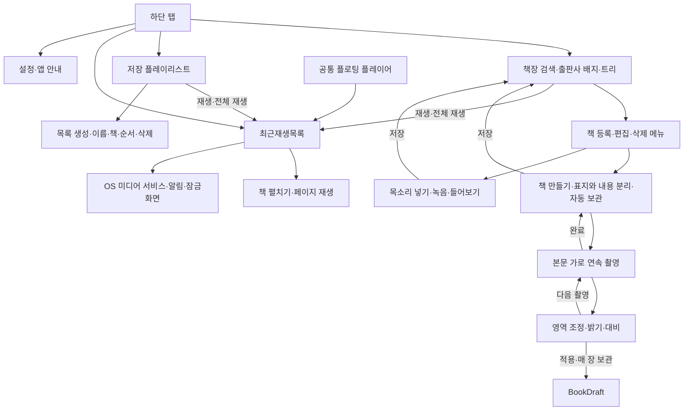

# 설계 — Astra 작은 도서관

> 2026-09-19 사용자 승인 개편. 0단계 시안의 5단계 제작/부모 공간 동선을 대체한다.
> [요구사항](requirements.md) · [작업 순서](tasks.md)

<!-- toc -->
- [1. 화면 구조](#1-화면-구조)
- [2. 디자인 토큰](#2-디자인-토큰)
- [3. 화면과 상태](#3-화면과-상태)
- [4. 데이터와 구현 경계](#4-데이터와-구현-경계)
- [5. 결정과 검증](#5-결정과-검증)
<!-- tocstop -->

## 1. 화면 구조

책장은 출판사→전집→번호·책 제목 트리다. 저장 플레이리스트 목록을 열면 같은 검색/분류 트리로 구성원을 탐색한다. 저장 순서는 플레이리스트 편집에서 따로 관리하며 전체 재생에 사용한다. 설정은 현재 시스템 테마/백그라운드 재생 준비 상태/로컬 보관 정책 안내를 제공한다. 미구현 설정 스위치를 노출하지 않는다.

## 2. 디자인 토큰

A-13의 따뜻함·둥근 형태를 Flutter에 적용한다. CSS 예제를 이식하지 않는다. 아래는 프로젝트 전용 팔레트 결정이며 전사 핑크 예시의 대체안이다.

| 역할 | 낮 | 밤 |
| :--- | :--- | :--- |
| 배경 | `#FFF9F0` 크림색 | `#191D2B` 밤하늘 |
| 표면 | `#FFFEFA` | `#252B3D` |
| 본문 | `#282B3A` 잉크 | `#F6F1E7` |
| 보조 본문 | `#626477` | `#B9BFCE` |
| 주요 버튼 | `#6350A0` | `#D1C2FF` |
| 주요 버튼 글자 | `#FFFFFF` | `#241B3D` |
| 장식 | 피치 `#EDC9B7`, 세이지 `#C5D4C0` | 저채도 파생색 |

- 장식색을 본문·작은 글자 배경에 바로 사용하지 않는다. 색 대비 검증은 실제 조합으로 수행한다.
- 제목 28/24, 본문 17, 보조 15 logical px. 한국어 시스템 폰트 사용, 폰트 확대를 제한하지 않는다.
- 간격 8·12·16·24·32, 버튼 모서리 22, 주요 표면 24, 환영 카드 30. 그림자는 약하게, 긴 문단은 좌측 정렬.
- 주요 아동 조작 최소 56dp. 버튼은 아이콘과 글자를 함께 제공한다. 스크린리더 이름에 동작과 상태를 담는다.
- 움직임은 짧은 상태 전환에만 사용하고 OS 모션 감소 시 생략한다. 별빛·맥박의 반복 애니메이션은 쓰지 않는다.
- 책 목록은 트리/행으로 재배치한다. 제작 폼 최대 폭은 600dp이며 화면과 글자 확대에 따라 세로 스크롤한다.
- 독서 화면은 현재 그림/컨트롤 상하 구조다. 가로 및 글자 확대 독서 화면 검증은 실기기 확인 과제로 남긴다.

## 3. 화면과 상태

| 화면 | 현행 동작 |
| :--- | :--- |
| 책장 | 검색, 등록된 출판사 배지, 전집 펼침, 책 정보/페이지 목록, 재생/전체 재생, 관리 메뉴 |
| 플레이리스트 | 생성·이름 변경·삭제, 책 추가/제외 및 드래그 순서 변경. 삭제는 참조 목록만 제거 |
| 최근재생목록 | 공통 오디오 소유자. ID·순서·현재 책을 로컬 저장. 책 순서 변경·제거·비우기. 저장 플레이리스트를 수정하지 않음 |
| 플로팅 플레이어 | 현재 책/페이지·재생/일시정지·재생목록 열기. 앱 내부 이동 시 유지 |
| 책 만들기 | 제목·출판사·전집·번호, 표지·본문 사진 촬영/자르기·순서·삭제 (2026-09-20 녹음은 목소리 넣기로 분리) |
| 목소리 넣기 | 페이지별 녹음·들어보기·글·기기 읽기 (`/content/:id/voice`) |
| 만들던 책 | 책장 메뉴에서 저장된 초안을 복원하거나 버림 |

책 등록·편집은 보호자 확인 화면 없이 바로 열린다. 만들던 책 목록과 플레이리스트 편집의 기존 확인은 유지한다. 편집 중 공통 재생 잠금은 유지한다. 자동저장은 900ms 유휴 후 수행하고 뒤로 갈 때도 저장한다. 저장 오류 시 떠나지 않고 입력/오류를 보여준다. 강제 종료 시 아직 저장되지 않은 입력의 보존은 보장하지 않는다.

## 4. 데이터와 구현 경계

- 기존 Content의 publisher/seriesId/volume, Series, Playlist.contentIds를 사용한다. Content JSON 마이그레이션 없음.
- CatalogViewModel은 책/전집/저장 Playlist/초안을 읽는다. 검색어·배지·트리 펼침은 세션 중 유지한다.
- Playlist는 index/playlists.json에 저장하며 삭제된 책 참조는 표시/재생에서 제외한다. IndexRepositoryBase는 쓰기를 직렬화해 동시 저장 유실을 막는다.
- PlaybackQueue는 앱 루트 provider가 소유한다. 저장 Playlist와 배열을 공유하지 않는다. 앱 재시작 시 최근 큐를 복원하되 자동 재생하지 않는다.
- 새 책 선택 시 최신 Content를 조회한다. 게시 직후 큐에 새 판을 반영하고 기존 VM은 폐기한다. 편집 후 구판 사진/음성 재생을 막는다.
- PlayerViewModel은 책/페이지 재생과 위치 저장 담당, 책 완료 콜백으로 Queue가 다음 책을 선택한다.
- FlutterTts의 실제 플랫폼 채널은 공유되므로 DeviceTtsService는 DI 단일 인스턴스다. PageAudioPlayer는 발화 시 콜백을 연결하고 파일 시작/이어재생을 세대 번호와 직렬 대기로 취소한다. 이전 책 해제는 공유 TTS를 해제하지 않는다.
- 서비스 준비 성공 시 큐는 앱 비활성화/화면 잠금에도 계속 재생한다. 미리듣기와 녹음은 기존대로 중단한다. 편집 화면이 열리면 공통 큐를 잠가 원격 재생 명령도 차단한다.
- drafts/id/data.json 및 reading_positions/id/data.json과 기존 library 저장 계약을 유지한다. 단계 enum은 구형 초안 호환을 위해 읽지만 화면에서는 사용하지 않는다.
- 게시 큐와 Content 버전 비교는 앱 안 단일 저장소 인스턴스 기준이다. 다중 프로세스 저장 트랜잭션은 보장하지 않는다. 이전·실패한 revision 의 자동 GC 는 없다(2단계 과제).
- 보호자 확인(`ParentBoundary`)은 우발 조작 방지이며 인증이 아니다. 앱 비활성화 시 다시 확인하고 입력 상태는 메모리에 유지한다.

### 1-1 저장 계약 (2026-09-19)

BookDraft는 drafts/id/data.json, ReadingPosition은 reading_positions/id/data.json에 저장한다. 읽기 위치는 페이지 ID 기준으로 복원하며 페이지가 삭제되면 첫 페이지를 사용한다. 기존 library/ReadingEvent JSON은 변경하지 않는다. 미래 스키마/손상 JSON/식별자 불일치는 거절한다. 실제 초안 버리기는 1-2 서비스가 메타와 초안 자산을 함께 정리한다.

### 1-2 제작과 미디어 계약

제작 저장은 BookAuthoringRepository를 통해 직렬 실행한다. 기존 책을 열면 사용 중인 사진/음원을 drafts/{id}/assets의 새 이름으로 복사한 뒤 초안을 저장한다. 가져온 파일은 삭제하지 않고 복사한다. 페이지 삭제·재녹음은 새 참조만 저장하며 이전 파일을 즉시 지우지 않는다.

저장 순서: 제목·전집·양수 책 번호·본문 사진 검사 → library/{id}/revisions/{uuid}로 새 미디어 복사 → 기존 책의 updatedAt 조건부 확인 → data.json 원자 교체. 기존 ContentRepository의 저장·삭제·조건부 게시가 동일 큐를 공유한다. 충돌/실패 시 기존 책과 초안을 보존한다. 기존 미디어는 현재 재생 화면이 참조할 수 있어 즉시 삭제하지 않는다.

게시 성공 뒤 초안 메타 삭제가 실패하면 성공 결과를 유지하고 경고를 기록한다. 잔존 초안으로 다시 게시하면 버전 충돌로 거절한다. 앱 강제 종료로 남은 미참조 파일의 자동 GC는 후속 안정화 범위이며 이번에는 임의 삭제하지 않는다. 수동 초안 버리기와 게시 성공 후 정리는 해당 drafts/id 메타와 미디어를 함께 지운다. 기존 library 파일은 보존한다.

TTS 완성 조건은 온디바이스 사용 가능성 검증 계약을 통해서만 통과한다. 기본 구현은 false이며 직접 녹음으로 한 권을 완성할 수 있다. 카메라/녹음 UI·미리듣기·라우팅을 연결했다. Android는 설치된 한국어 음성의 network_required=0과 setVoice 성공을 확인한다. iOS는 오프라인 여부를 확인할 계약이 없어 직접 녹음을 안내한다. 실기기 비행기 모드 검증은 미실행.

## 5. 결정과 검증

- 사용자 요청으로 기존 UI/코드 구조의 보존 의무는 없다. 사용자 데이터 호환성과 미커밋 타 프로젝트 변경은 보호한다.
- 저장 플레이리스트 기능을 3단계에서 앞당겼다. 연령별 배지, OCR/다자녀·백업·클라우드·AI는 이번 범위가 아니다.
- 모델/VM·실제 파일 IO·Flutter 위젯 테스트로 검증하고 Android debug APK를 만든다. 실기기 촬영/녹음/오프라인 음성 테스트는 사용자 요청으로 보류한다.
- 화면 테스트에 쓰는 책은 합성 데이터이며 사용자 기기에 샘플 데이터를 넣지 않는다.

### 1-5 아기자기한 책방 표현 (2026-09-20)

음악 앱형 정보 구조/동작을 유지하고 A-13의 피치·민트·라벤더와 둥근 형태를 Flutter에 적용한다. 책장/플레이리스트 상단에 짧은 환영 문구와 CustomPainter 책 친구를 배치한다. 책 친구는 탭하면 700ms 한 번 인사하고 정지한다. 하단 탭 선택은 280ms, NavigationBar는 300ms, 트리 펼침은 260ms로 반응한다. OS disableAnimations가 켜지면 전부 즉시 전환한다. 반복 장식·소리·외부 이미지 요청은 없다.

좁은 폭(<280 콘텐츠 dp) 또는 글자 배율이 큰 경우 환영 카드의 캐릭터와 문구를 세로 배치한다. 장식 도형은 읽기 접근성에서 제외하며 인사 조작에는 이름을 제공한다. 실제 책 사진이 있으면 사진을 우선하고, 표지 누락 시 책 친구를 표시한다. 본문 글꼴은 시스템 기본을 유지하며 추가 폰트/패키지는 설치하지 않는다.

팔레트: 낮 환영 카드 #FFE9DB→#FFF5DE, 플레이리스트 #E6F3E9→#F5F1DF, 밤 #34304A→#293C40. 본문 #282B3A/#F6F1E7, 출판사 표지 #DBEEE3와 #284E40. 주요 8개 대비 조합 5.63~12.94:1. 모든 UI 요소 접근성 인증을 의미하지 않는다.

### 책 등록 단순화 (2026-09-20)

책장 ＋ → 책 만들기 직행. 출판사는 선택, 전집과 1 이상의 정수 책 번호는 필수이며 저장소에서도 검증한다. 상단 `저장` 한 개로 검증→책장 반영→책장 복귀한다. `초안 저장`/`책장에 넣기` 구분은 제거했다. 내부 900ms 자동 보관·뒤로 가기 보관은 유지해 미완성 입력을 보호한다. 본문 사진과 페이지별 녹음/확인된 기기 읽기라는 완성 조건은 유지한다.

`책 표지`의 촬영/다시 촬영은 Content.coverPath에 저장하고, `내용 촬영`은 BookPage를 추가한다. 표지는 본문 쪽수·재생 순서에 들어가지 않는다. 표지 교체와 본문 편집은 독립이다. 기존 데이터는 마이그레이션하지 않고 재편집 때 필수 분류를 보완한다.

### 본문 연속 촬영

내용 연속 촬영 → 가로로 펼친 책 촬영 → 같은 화면에서 계속 촬영 → 완료. 각 장은 초안 보관 성공 후 장수를 확정한다. 저장 실패는 재촬영 없이 재시도하고, 실패 사진을 제외하고 나갈 때 확인한다. 표지는 단일 촬영이며 본문은 한 장에 좌우 면을 담는다. 방향 제한은 촬영 화면에만 적용한다.

### 사진 제작·음성 분리와 보정

사진만으로 책을 저장할 수 있다. 제작은 사진·순서·삭제 중심이며 녹음/들어보기·글·TTS는 책장 목소리 넣기로 이동한다. 촬영 후 카메라를 잠시 닫고 사각형 영역과 밝기/대비를 조정한다. 적용 후 본문 연속 촬영을 재개한다. 원본 파일을 덮지 않고 새 PNG로 보관하며 기존 페이지 ID와 음성 연결을 유지한다. 사각형 수동 자르기이며 자동 문서 검출/원근 보정은 아니다.

## 2-2a 설계 (2026-09-22)

Settings → BackupScreen/BackupViewModel → 저장대기 → directory snapshot → BackupBundle → Android SAF. 역방향은 SAF → private cache copy → BackupBundle.inspect → 결과이며 active library 변경 없음. 상세 형식·Mermaid·보안 경계는 [1_DESIGN §1.2 백업·복원](../../1_DESIGN.md#12-시스템-아키텍처)을 따른다.

## 2-2b 설계 결정 (2026-09-28)

동일 baseDir의 네 루트를 저널/rename으로 교체한다. repository는 캐시가 없으므로 DI를 재생성하지 않고 쓰기를 배수/차단한다. 동일 큐/OS handler를 유지한 채 무음 재조회해 참조 분리 위험을 피한다. 화면 VM과 이미지 캐시를 갱신한다. 상세 트랜잭션 Mermaid와 의미 검증 경계는 [1_DESIGN §1.2 백업·복원](../../1_DESIGN.md#12-시스템-아키텍처)과 ADR-13 이 정본이다.
