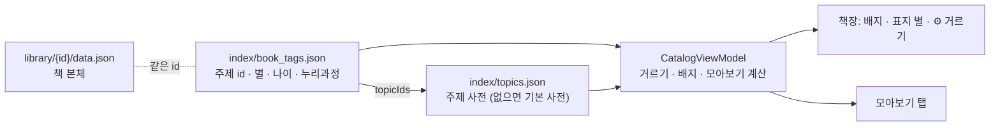

# 설계 — 주제 배지 · 즐겨찾기 · 모아보기 (1차)

> 요구사항: [requirements.md](requirements.md). 이 문서는 **1차(실제 앱)** 만 다룬다. 영상처럼 보기 · 방 고르기 · 누리과정 알림은 [tasks.md](tasks.md) 의 다음 차례.

## 한눈에

- 책에 붙는 꼬리표(주제 · 즐겨찾기 · 나이 · 누리과정)는 **책 데이터와 따로** `index/book_tags.json` 에 둔다.
- 주제 이름은 **사전** `index/topics.json` 에 두고, 책은 주제 id 만 가리킨다.
- 모아보기는 **저장하지 않는다.** 열 때마다 꼬리표에서 계산한다.
- 두 파일 모두 `.mcrb` 백업에 들어가고(이미 `index/` 전체를 담는다), 복원 검사가 행을 하나하나 확인한다.

왜 꼬리표를 책 안(Content.tags)에 넣지 않았나

- 책 데이터는 초안 → 게시 → 조건부 교체(리비전 검사) 흐름을 탄다. 별 하나 누르는 데 이 흐름을 태우면
  편집 중인 초안과 부딪히고 `updatedAt` 이 바뀌어 "다른 곳에서 고쳤어요" 충돌이 난다.
- 꼬리표는 책 내용이 아니라 "우리 집이 이 책을 어떻게 나누나"다. 나중에 가족 계정(M2c)이 생겨도 가족마다 다를 수 있다.
- `Content.tags`(문자열 목록)는 그대로 두고 쓰지 않는다 — 지우면 저장 포맷이 바뀐다.

데이터 모양

`index/topics.json` — `{schemaVersion: 1, data: [Topic…]}`

| 필드 | 뜻 |
| :--- | :--- |
| `id` | 영문 · 숫자 · `-` · `_` (복원 검사 규칙). 기본 사전은 `science-environment-air` 처럼, 보호자가 더한 것은 uuid |
| `name` | 화면 이름 |
| `parentId` | 부모 주제(없으면 큰 주제) |
| `emoji` · `order` | 아이용 그림 하나 · 같은 부모 안 순서 |

`index/book_tags.json` — `{schemaVersion: 1, data: [BookTags…]}`

| 필드 | 뜻 |
| :--- | :--- |
| `id` | 책 id (책 한 권에 한 줄) |
| `topicIds` | 주제 id 목록. 사전에서 지워진 id 는 화면에서 무시 |
| `favorite` | 즐겨찾기 |
| `ageMin` · `ageMax` | 권장 나이. 둘 다 없으면 나이별 모아보기에 안 나온다 |
| `nuriAreas` | `body` · `communication` · `social` · `art` · `nature` 중 보호자가 고른 것 |

- 꼬리표가 하나도 없으면 행을 지운다. 책을 지우면 행도 지운다(남은 행은 무시 — 고아 허용).
- 사전 파일이 없으면 기본 사전 14개를 보여 주고, 보호자가 처음 주제를 더할 때 기본 사전과 함께 저장한다.
- `fromJson` 방어: 모르는 누리과정 값은 버리고, 0~19 밖의 나이는 버리고, 거꾸로 된 나이는 바꾸고, 중복 주제는 하나로.

화면

- **책장:** 인사 카드를 지우고 검색이 제목 바로 아래. 거르기 줄(전체 · ⭐ · 큰 주제 · 나이 · 출판사)은 ⚙ 를 누르거나 검색어가 있을 때만 보인다. 닫으면 조건도 풀린다.
- **책 줄:** 표지 56×72 고정, 오른쪽 아래에 작은 별(눌러서 즐겨찾기), 제목 한 줄, 배지 한 줄(주제 · 나이 · 쪽수 — 넘치면 잘림). 큰 주제마다 배지 색이 같다.
- **책 메뉴 › 주제 · 나이 정하기:** 보호자 확인 뒤 시트. 별 · 주제 칩(사전 전체) · 주제 추가 · 나이 범위 · 누리과정 5영역 → 저장.
- **모아보기 탭(3번째):** 즐겨찾기 / 주제별(큰 주제마다 "과학 몰아보기") / 나이별(3~8세) / 누리과정 5영역. 책이 있는 묶음만 보인다. 눌러 열면 책 목록과 전체 재생.
- **설정 › 최근재생목록:** 탭에 있던 목록을 그대로 옮겼다.

